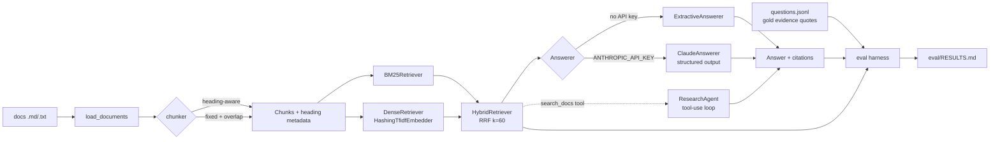

# rag-eval-kit

A small retrieval-augmented generation (RAG) toolkit built around its evaluation harness. It loads
markdown/text docs, chunks them two ways, retrieves with BM25 (implemented from scratch), a dense
retriever over hashed n-gram TF-IDF vectors (pure numpy, no model download, works offline) and a
Reciprocal Rank Fusion hybrid, then answers with citations. Answers come from Claude when an API key is
set and from a deterministic extractive answerer when it isn't. The interesting part is the measurement:
a bundled synthetic corpus and 100 hand-written questions (single-hop, multi-hop and unanswerable). Gold
relevance is defined by evidence quotes rather than chunk ids, so different chunking strategies are
scored against the same gold set. One command reports Recall@k, MRR, nDCG@10, answer token F1, citation
precision, refusal accuracy and latency.

## Features

- **Ingestion**: recursive loader for `.md`/`.markdown`/`.txt`; a fixed-size word-window chunker with
  overlap; a heading-aware chunker that keeps the heading path (`Plans and Pricing > Trials`) as
  metadata, ignores `#` inside code fences, merges tiny sections forward and splits long ones.
- **Retrieval**: Okapi BM25 over an inverted index; `DenseRetriever` with a pluggable `Embedder`
  protocol (the default `HashingTfidfEmbedder` hashes word uni/bi-grams and character 3-5-grams with
  signed feature hashing, then applies TF-IDF weights); `HybridRetriever` with weighted RRF.
- **Answering**:
  - `ExtractiveAnswerer` (offline default): picks sentences by greedy IDF-weighted coverage, cites them
    as `[n]`, and refuses when the retrieved chunks don't cover the question's terms.
  - `ClaudeAnswerer`: `claude-opus-5-5` via the official `anthropic` SDK. It answers only from the
    numbered sources and returns a structured answer (`messages.parse` + Pydantic) with `answerable`
    and `citations`.
  - `ResearchAgent`: a hand-written tool-use loop with `search_docs` and `get_chunk` tools, so Claude
    can search more than once for multi-hop questions. The tool-call trace is returned.
- **Evaluation harness** (`python -m rag_eval_kit.eval`): compares retrievers across chunkers, scores
  answers, sweeps the extractive answerer's two parameters, and writes `eval/RESULTS.md`. An optional
  `--judge claude` mode scores faithfulness with Claude as the judge.
- **CLI**: `rag-eval-kit ask "question"` and `rag-eval-kit eval`.

## Architecture



The main design decisions:

- **Gold labels are evidence quotes, not chunk ids.** A chunk counts as relevant when it comes from
  the evidence document and contains the quote. The same 100 questions therefore score any chunker,
  and a test checks that every quote can be found under both chunkers.
- **Recall@k is per evidence item.** A multi-hop question reaches recall 1.0 only when every hop's
  evidence is in the top k. "Multi-hop full recall@5" reports the share of multi-hop questions where
  all hops were retrieved.
- **Retrievers index `heading + body`**, so a section titled "Token lifetimes" can match a question
  about token lifetimes even when the body never repeats the words.
- **The dense retriever is honest about what it is.** Hashed TF-IDF with character n-grams handles
  morphology (`signing` / `signature`) but not synonyms. It sits behind an `Embedder` protocol
  (`fit`, `embed`), so a real embedding model can replace it without changing the retriever or the
  harness. The tests plug in a toy embedder this way.
- **Every LLM call goes through one small layer** (`llm.py`). It uses `claude-opus-5-5` with
  `output_config={"effort": "medium"}` and the server-side refusal fallback (beta header plus
  `fallbacks: "default"`). It checks `stop_reason` (refusals and truncation raise `LLMError`) and
  catches SDK errors most-specific-first. Tests swap in a scripted fake client, so they never touch
  the network.

## Quickstart

```bash
python -m venv .venv
source .venv/bin/activate        # Windows (Git Bash): source .venv/Scripts/activate
pip install -e ".[dev]"

rag-eval-kit ask "How long are idempotency keys stored?" --retriever bm25 --k 3
```

Real output (offline, no API key set):

```text
[ExtractiveAnswerer | bm25 retrieval]
Idempotency keys are stored for 24 hours. [1]

Sources:
 *[1] api-idempotency#1  Idempotent Requests > Key retention  (score 9.775)
  [2] api-idempotency#0  Idempotent Requests > Idempotency keys  (score 9.672)
  [3] security-encryption#1  Encryption and Compliance > Customer-managed keys  (score 6.943)
```

An unanswerable question is refused:

```text
$ rag-eval-kit ask "Is Larkspur HIPAA compliant?"
[ExtractiveAnswerer | hybrid retrieval]
I could not find the answer in the provided documents.
```

More commands:

```bash
rag-eval-kit ask "..." --corpus path/to/your/docs   # any folder of .md/.txt files
rag-eval-kit ask "..." --agent                      # multi-hop tool-calling agent (needs ANTHROPIC_API_KEY)
python -m rag_eval_kit.eval                         # offline evaluation, writes eval/RESULTS.md
python -m rag_eval_kit.eval --answerer extractive --answerer claude --answerer agent --judge claude
```

With `ANTHROPIC_API_KEY` set (see `.env.example`), `ask` uses `ClaudeAnswerer` automatically. Pass
`--offline` to force the extractive answerer.

## Results

All numbers below are **offline baseline numbers**: BM25, hashed TF-IDF dense, hybrid, and the
extractive answerer. No LLM was called.

- **Command:** `python -m rag_eval_kit.eval` (full output in [`eval/RESULTS.md`](eval/RESULTS.md))
- **Data:** the bundled **synthetic** corpus for "Larkspur", a fictional project-management SaaS:
  40 short docs (34 topic docs + 6 distractors such as a changelog and retired plans), 97 heading-aware
  chunks. There are 100 hand-written questions: 76 single-hop (13 of them paraphrased to share few
  words with the docs), 12 multi-hop and 12 unanswerable.
- **Machine:** Windows 11 Pro (10.0.26300), Intel64 Family 6 Model 151 CPU (16 logical cores), Python
  3.13.12, numpy 2.5.4. Latency is in-process wall time per query.
- **Date measured:** 2026-11-06

### Retrieval (88 answerable questions)

| chunker | retriever | Recall@1 | Recall@3 | Recall@5 | Recall@10 | MRR | nDCG@10 | multi-hop full recall@5 | p50 ms | p95 ms |
|---|---|---|---|---|---|---|---|---|---|---|
| heading | bm25 | 0.784 | 0.903 | 0.943 | 0.955 | 0.880 | 0.897 | 1.000 | 0.07 | 0.18 |
| heading | dense | 0.790 | 0.909 | 0.955 | 0.955 | 0.887 | 0.902 | 1.000 | 0.55 | 0.90 |
| heading | hybrid | 0.790 | 0.915 | 0.955 | 0.955 | 0.887 | 0.903 | 1.000 | 0.62 | 0.98 |
| fixed | bm25 | 0.756 | 0.926 | 0.960 | 0.966 | 0.878 | 0.893 | 0.917 | 0.09 | 0.17 |
| fixed | dense | 0.795 | 0.926 | 0.966 | 0.977 | 0.901 | 0.910 | 1.000 | 0.44 | 0.73 |
| fixed | hybrid | 0.767 | 0.926 | 0.966 | 0.977 | 0.886 | 0.901 | 1.000 | 0.70 | 1.17 |

### Answering (heading chunks, top-5 contexts, all 100 questions)

| retriever + answerer | token F1 | answer recall | citation precision | refusal accuracy (unanswerable) | false refusal rate (answerable) | p50 ms | p95 ms |
|---|---|---|---|---|---|---|---|
| bm25 + extractive | 0.284 | 0.660 | 0.855 | 0.750 | 0.136 | 0.21 | 0.43 |
| dense + extractive | 0.278 | 0.628 | 0.878 | 0.750 | 0.159 | 0.60 | 0.87 |
| hybrid + extractive | 0.282 | 0.647 | 0.862 | 0.750 | 0.136 | 0.76 | 1.10 |

How to read these numbers:

- On this small corpus the three retrievers are within about one question of each other. For example,
  heading-chunk Recall@5 is 0.943 for BM25 and 0.955 for dense and hybrid; 88 questions is far too
  few to call that a meaningful difference. Hybrid never ranks below the weaker of its two parts here,
  but it doesn't beat the better one by a clear margin either.
- The misses are almost all paraphrases. With heading chunks, all 4 hybrid Recall@5 misses are among
  the 13 paraphrased questions, and none are among the other 75 answerable questions. BM25 misses
  one more paraphrase. Lexical and hashed features can't bridge "billed in euros" and "EUR".
- Fixed 80-word windows (20-word overlap) score slightly higher at Recall@3-10 but lower at Recall@1.
  Many docs fit in one or two windows, so a single window often covers both hops.
- The extractive answer's token F1 is low (0.28) by construction: it returns whole sentences while the
  gold answers are short phrases. Answer recall (about 0.65 of gold answer tokens present) is the
  fairer offline signal.
- Refusal is a trade-off. `eval/RESULTS.md` includes a sweep: raising `min_coverage` from 0.5 to 0.8
  lifts refusal accuracy from 0.750 to 0.917, but false refusals rise from 0.136 to 0.534. The
  defaults were picked from these sweeps on the same question set (no held-out split).
- **LLM numbers: not measured.** `--answerer claude`, `--answerer agent` and `--judge claude` are
  implemented but were not run for this README (no API key was set). The harness skips them and says
  so in `RESULTS.md` instead of reporting anything.

## Tests / CI

```bash
pytest -q          # 56 passed in ~1.6 s on the machine above
ruff check src tests && ruff format --check src tests
mypy               # strict mode
```

The tests cover tokenisation and stemming, both chunkers (overlap windows, heading paths, code
fences, merge/split rules), BM25 against a hand-computed score, embedder determinism and
normalisation, a custom `Embedder` plug-in, RRF arithmetic, extractive citing and refusal,
`ClaudeAnswerer` request options and refusal handling, the agent loop (multi-hop trace, tool errors,
turn limit), SDK error translation, every metric, and the bundled dataset's integrity. The Claude
code paths run against a scripted fake client, and an autouse fixture removes `ANTHROPIC_API_KEY`
so tests never call the network.

GitHub Actions (`.github/workflows/ci.yml`) runs lint, format check, mypy, pytest and an offline eval
smoke run on Python 3.11 and 3.13.

## Limitations and next steps

- **The dataset is small, synthetic and written by the same person who wrote the system.** It has 40
  docs and 100 questions about a fictional product. That's enough to catch regressions and compare
  configurations, but not to make claims about real-world retrieval quality. Differences of one or
  two questions are noise.
- **No held-out split.** The extractive answerer's `min_coverage` and `min_gain` defaults were chosen
  by looking at sweeps on the evaluation questions.
- **The "dense" retriever is not semantic.** Hashed TF-IDF matches surface forms and morphology, not
  meaning. Paraphrased questions (for example "billed in euros" against "EUR") are where it and BM25
  both fail. A real embedding model plugged in through `Embedder` is the obvious next experiment.
- **The extractive answerer is a baseline.** It can't combine facts. For "the plan that costs $24",
  it returns the price sentence and a generic rate-limit sentence, not "1,000 requests per minute".
  Multi-hop questions are what `ResearchAgent` is for, and its quality is unmeasured here.
- **Citation precision is document-level**: a cited chunk counts as correct when it comes from a gold
  document, even if it's a different section of that document.
- **Tokenisation is English-only**: a hand-rolled suffix stemmer and stopword list.
- **Next steps:** run and report the Claude answerer, agent and judge numbers. Score the agent's
  retrieval trace with the same Recall@k. Add a held-out question split. Add a real embedding backend
  and a cross-encoder re-ranker.

## License

MIT, see [LICENSE](LICENSE). All product names, policies and numbers in the bundled corpus are fictional.
